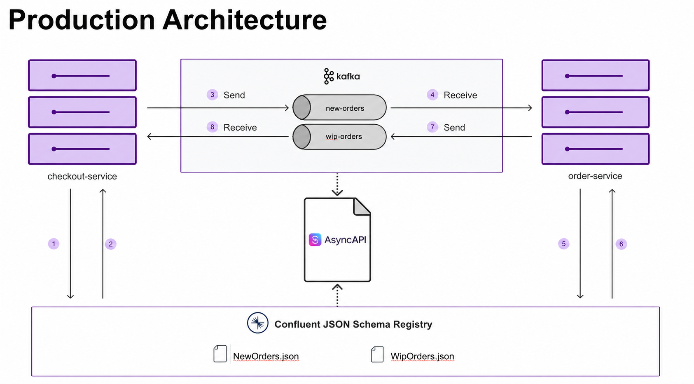
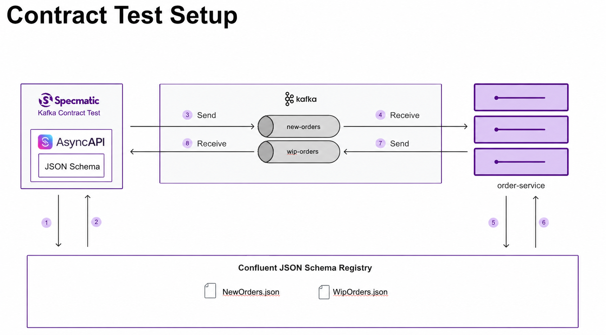

# Contract Testing with AsyncAPI and Confluent JSON Schema Registry

> **Leverage JSON Schemas registered in Confluent Schema Registry from an AsyncAPI spec to contract test event-driven microservices.**

## Overview

This project demonstrates contract-driven development for asynchronous microservice communication using AsyncAPI, Kafka, Confluent Schema Registry, and JSON Schema Draft-07.



`order-service` consumes `new-orders` and publishes a processing event to `wip-orders`. Both values use Confluent JSON Schema wire format.

## Referencing your existing JSON Schema Registry schemas in AsyncAPI spec

AsyncAPI reuses schemas registered in Schema Registry instead of redefining them. Schema Registry remains the single source of truth.

```yaml
components:
  messages:
    OrderRequest:
      name: OrderRequest
      title: An order request
      payload:
        schemaFormat: 'application/schema+json;version=draft-07'
        schema:
          $ref: '<SCHEMA_REGISTRY_URL>/subjects/new-orders-value/versions/1/schema'
```

`<SCHEMA_REGISTRY_URL>` comes from `SCHEMA_REGISTRY_URL`. In this sample, it resolves to `http://schema-registry:8085` in Docker.

## Contract Testing application

### Prerequisites

- Java 17+
- Docker and Docker Compose
- Locally built `specmatic/enterprise` image with JSON Schema Registry support



`order-service` is system under test.

### Run Contract Tests Programmatically

```bash
# Pull Kafka and Schema Registry dependencies
docker compose pull

# Run contract test only
./gradlew clean test --tests "com.example.order.ContractTestUsingTestContainer"
```

Run [contract test](src/test/kotlin/com/example/order/ContractTestUsingTestContainer.kt) from IDE too. Testcontainers starts Kafka and Schema Registry, registers JSON schemas, then runs Specmatic against `order-service`.

Check Gradle test logs for Kafka, Schema Registry, `order-service`, and Specmatic output. Open HTML report after test:

```text
build/reports/specmatic/async/test/html/index.html
```

#### Test Configuration

Contract test configures:

```properties
SCHEMA_REGISTRY_URL=http://schema-registry:8085
SCHEMA_REGISTRY_KIND=CONFLUENT
AVAILABLE_SERVERS=broker:9093
```

### Run Contract Tests using Docker CLI

This shows independent app, Kafka, Schema Registry, schema registration, and Specmatic test components.

1. Pull dependencies:

```bash
docker compose --profile test pull
```

2. Start dependencies, `order-service`, and Specmatic contract test:

```bash
docker compose --profile test up --build -d
```

3. Inspect contract-test and application logs:

```bash
docker compose --profile test logs specmatic-test order-service
```

4. Open HTML report:

```text
build/reports/specmatic/async/test/html/index.html
```

5. Stop containers:

```bash
docker compose --profile test down -v --remove-orphans
```

## What Specmatic contract test checks

- Message delivery to correct topics
- JSON Schema Registry payload validation
- Confluent JSON Schema wire-format serialization
- Consumer reply behavior
- Invalid-message handling

## Schema Management

### Schema Organization

```text
src/main/jsonschema/
├── NewOrders.json     # Order creation events
└── WipOrders.json     # Work-in-progress updates
```

### Registration Process

`src/test/jsonschema/register-schema.sh` registers both schemas as `schemaType: JSON` during test setup. `order-service` publishes `JsonNode` payloads through `KafkaJsonSchemaSerializer`, passing the registered schema explicitly with `JsonSchemaUtils.envelope`.

### Subject-name strategy

Confluent default value subject is `<topic>-value`; this sample's references follow it. If registry subject differs, configure `value.subject.name.strategy` in producer properties.

## Why This Matters

- Catch integration issues before higher environments
- Keep AsyncAPI contract aligned with registered schemas
- Validate field-level Kafka payloads
- Detect schema incompatibility before deployment
